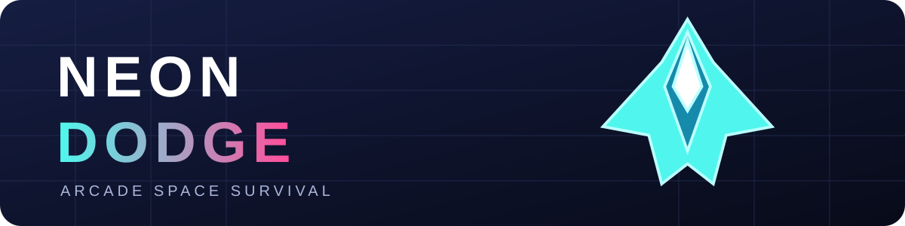

# NEON DODGE

<strong>Arcade espacial para navegador e celular.</strong> Desvie dos destroços, colete moedas e sobreviva o máximo possível.

<a href="https://projectgithubrepository.github.io/simpleGame/?v=layout-thrust-readme-4"><strong>▶ JOGAR AGORA</strong></a>

## Como jogar
- **Celular:** segure ← ou → nos controles abaixo da tela.
- **Computador:** use ← / → ou A / D.
- **Impulso:** os propulsores laterais acendem enquanto você mantém a direção.
- **Objetivo:** desvie dos obstáculos e colete itens.

## Guia visual dos itens
<table><tr>
<td align="center" width="25%"> <strong>MOEDA</strong> +5 no saldo</td>
<td align="center" width="25%"> <strong>ESCUDO (S)</strong> Bloqueia 1 impacto</td>
<td align="center" width="25%"> <strong>LENTIDÃO (L)</strong> Obstáculos 50% mais lentos por 5s</td>
<td align="center" width="25%"> <strong>DESTROÇO</strong> Evite a colisão</td>
</tr></table>

## As três naves e seus poderes
- **Viper — Overdrive:** acelera a nave em 48% por 2,2 segundos.
- **Phantom — Fase:** atravessa destroços sem sofrer colisão por 1,25 segundo.
- **Titan — Pulso EMP:** reduz em 50% a velocidade dos destroços por 3,2 segundos.
- **Equilíbrio:** os três poderes têm recarga comum de 18 segundos. Ative pelo botão **ESPECIAL** no celular ou pela tecla **Espaço** no computador.

A escolha da nave fica disponível somente antes de iniciar. Depois que a partida começa, os botões ficam bloqueados; ao terminar, você pode escolher outra nave para a próxima rodada.

## Regras rápidas
- **Moeda dourada ($):** ao tocar, adiciona 5 moedas ao saldo salvo no navegador.
- **Escudo azul (S):** ao coletar, aparece um anel azul ao redor da nave. A próxima colisão é anulada e consome o escudo. Sem escudo, a colisão encerra a partida.
- **Lentidão roxa (L):** ao coletar, reduz em 50% a velocidade dos destroços durante 5 segundos.
- **Poder especial:** botão ESPECIAL (celular) ou Espaço (computador), com recarga de 18 segundos.
- **Propulsor lateral:** efeito visual enquanto você mantém um comando de direção; não é um item coletável.
- **Toque no celular:** seleção de texto, menu de copiar e callout de toque desativados para não atrapalhar os controles.

## Projeto
- HTML, CSS e JavaScript puro.
- Sprites desenhados em canvas e extrudados em camadas (*sprite stacking*).
- Recorde, moedas e nave escolhida ficam salvos no dispositivo.
- Testes automatizados: `npm test`.
- Publicação automática via GitHub Actions e GitHub Pages.

## Links
- [Jogar Neon Dodge](https://projectgithubrepository.github.io/simpleGame/)
- [Código-fonte no GitHub](https://github.com/projectgithubrepository/simpleGame)
